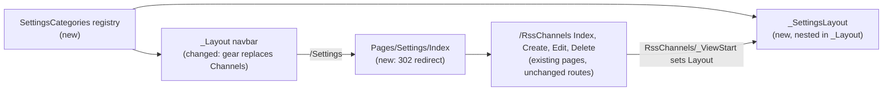

# Settings panel

Refs: #1

## 📝 TLDR
Today, managing RSS channels is a top-level `Channels` link in the navbar, beside `News`. The proposal replaces that link with a gear icon that opens a **Settings** area. The area has a left-hand category menu, `Channels` is its first category, and new categories can be added later without touching the navbar. The navbar stays focused on reading. All existing channel URLs keep working unchanged.

## 📝 Resolved assumptions (autonomous defaults)

| # | Question | Applied default | Why | Confirm? |
|---|----------|-----------------|-----|----------|
| Q1 | What is the "settings panel": a full page, an offcanvas drawer, or a modal? | A **full page** with a left-hand category menu. On narrow screens the menu stacks above the content. | Channel CRUD already runs as full pages (`Create`, `Edit`, `Delete`) with server-side validation, which doesn't fit a drawer or modal without rewriting it as AJAX. A page can be deep-linked, needs no new JavaScript, and is simple to change into a drawer later. | reversible |
| Q2 | Should channel pages move to `/Settings/Channels/*` URLs? | **No.** `/RssChannels/*` stays the canonical route. The new `/Settings` route redirects to the first category. | The `/RssChannels/*` routes are a protected surface (`BACKWARD_COMPATIBILITY.md` §3). Keeping them avoids redirects and broken bookmarks, and an alias can be added later through `AddPageRoute` without breaking anything. | reversible |
| Q3 | How are categories defined so the panel is "expandable"? | A **static, in-code registry** in the Web project (title, icon, entry page, and the pages that belong to it). No database table and no per-user settings. | It's the smallest change that delivers extensibility: adding a category means one registry line plus its pages. Storing actual setting values is a separate feature. | reversible |

## 📝 Problem Statement
- Channels is configuration, not content, yet it sits in the primary navbar on equal footing with `News`. Each future configuration screen (for example refresh interval, display options, or retention) would add another top-level link.
- The issue asks for one entry point, a gear icon, that groups configuration into categories, with `Channels` as the first.

## 📝 Proposed Solution
- **Gear icon in the navbar.** The `Channels` nav item becomes a gear icon (`bi-gear`) aligned to the right of the navbar. It links to `/Settings`, has `aria-label="Settings"` and a `title` tooltip, and shows as active whenever the current page belongs to any settings category.
- **`/Settings` entry page.** A new Razor page returns `RedirectToPage(first.EntryPage)` (302 to `/RssChannels` today), so the gear always lands on something useful.
- **Settings layout.** A nested layout `Pages/Shared/_SettingsLayout.cshtml`, inheriting `_Layout`, renders a "Settings" heading, a vertical category menu (Bootstrap `list-group` or `nav-pills`) driven by the registry with the current category highlighted, and the page body on the right. It must re-declare `@section Scripts { @RenderSection("Scripts", required: false) }`, because `Create.cshtml` and `Edit.cshtml` define a `Scripts` section (client-side validation). Without it, Razor throws "section defined but not rendered" on those pages.
- **Category registry.** `SettingsCategories` in `Home.Scout.Web/Settings/` holds an ordered list of `SettingsCategory(Key, Title, Icon, EntryPage, PagePrefix)`. `Channels` is entry 1, with `EntryPage = "/RssChannels/Index"` and `PagePrefix = "/RssChannels"`. The layout and the gear's active state both read from it.
- **Channels moved into the panel.** `Pages/RssChannels/_ViewStart.cshtml` sets `Layout = "_SettingsLayout"`, so `Index`, `Create`, `Edit` and `Delete` all render inside the panel without any change to their page models or handlers.

**Alternatives considered:**
- An offcanvas drawer or modal. It would need the CRUD forms rewritten as AJAX partials, and there's no deep link. Rejected for now (Q1).
- A navbar dropdown under the gear that lists the categories. It adds a click for a single category and still needs a settings page. It could be layered on later.
- Moving the pages under `Pages/Settings/Channels/`. This changes URLs that `BACKWARD_COMPATIBILITY.md` protects (Q2).

**Market check:**
- FreshRSS and Tiny Tiny RSS both put configuration behind a gear or "Preferences" entry, with a left or tab category menu, and both keep feed management as one category among several. That matches this design.
- Both also carry heavy per-user preference storage, which this spec deliberately skips: there are no setting values yet.

## 📝 Architecture
Only the Web layer is affected. Domain, Application, Infrastructure and the worker are untouched.



The registry is the single source of truth for which pages are "settings". Both the nested layout (menu and active item) and the navbar (gear active state) read it, so adding a category never touches `_Layout`.

## 📝 UI/UX

```
┌ Scout   News                                              ⚙ ┐   ← gear replaces "Channels", right-aligned
├──────────────────────────────────────────────────────────────┤
│ Settings                                                     │
│ ┌──────────────┐  RSS Channels                [+ Add channel]│
│ │▌📡 Channels  │  ┌────────────────────────────────────────┐ │
│ │              │  │ Name │ URL │ Description │ Added │ ... │ │
│ └──────────────┘  └────────────────────────────────────────┘ │
└──────────────────────────────────────────────────────────────┘
 < md: the category menu stacks above the content as a horizontal pill row
```

- **Active states:**
  - The gear is active (`active` plus `aria-current="page"`) on every page belonging to a settings category, which today means every `/RssChannels/*` page. `/Settings` itself never renders; it only redirects.
  - The `Channels` menu item is active on `/RssChannels`, `/RssChannels/Create`, `/RssChannels/Edit/{id}` and `/RssChannels/Delete/{id}`.
- **Accessibility:**
  - The gear link has `aria-label="Settings"`, a visually-hidden "Settings" text, and a `title` tooltip.
  - The category menu is a `<nav aria-label="Settings categories">`.
- **Mobile:** the gear sits inside the existing collapsed navbar menu, labelled with visible text "Settings" below the `sm` breakpoint, so it's never icon-only in a vertical list.
- **Unchanged:** the `RssChannels` pages keep their content, headings, status alert, empty state and hardcoded `/RssChannels/...` links. The `/News` empty state (`News/Index.cshtml`) also links to `/RssChannels`; the link still works and now lands inside the panel. Only the outer `container py-4` wrapper moves into `_SettingsLayout` to avoid double padding.
- **Page titles:** each page keeps its own `ViewData["Title"]`. The settings layout adds the "Settings" heading above it.
- Prototype: none. Mockups were skipped for this run; see the spec PR.

## 📝 Edge Cases & Failure Scenarios
- **Empty registry** (a future misconfiguration): `/Settings` returns 404 instead of redirecting into nothing, and the gear is still rendered. A unit test pins that the registry is non-empty.
- **Old bookmarks** to `/RssChannels/*` keep working and now render inside the panel. Nothing breaks.
- **Errors on channel pages** (for example DB unavailable): behavior is unchanged. The existing error handling and status messages render inside the settings layout.
- **`Fetch now` POST** redirects back to `RedirectToPage()` (`/RssChannels`), which is still inside the panel.
- **Pre-existing:** the navbar brand links to `/Index`, which has no page. It is out of scope, but it shouldn't be confused with this change.

## 📝 Risks & Impact Review
- **Contracts:** no route, schema, configuration or data change. The `BACKWARD_COMPATIBILITY.md` §3 routes are preserved, and `/Settings` is additive.
- **External dependency:** Bootstrap Icons is already loaded from the jsDelivr CDN in `_Layout`. If the CDN fails, the gear would be invisible, so the visually-hidden label and a `title` keep it reachable for screen readers. A text fallback isn't otherwise needed for a self-hosted app with the same dependency already on every page.
- **Rollback:** revert the PR. No state to undo.
- **QA:** user-facing navigation change, so `needs-qa` applies.

## 📋 Phasing
- **Phase 1: Foundations.** Test harness, category registry, and the `/Settings` redirect. Shippable alone: `/Settings` lands on Channels, and the UI is unchanged.
- **Phase 2: Settings panel.** `_SettingsLayout` wraps the channel pages, and the gear replaces the `Channels` nav link.

## 📋 Implementation Plan

### Phase 1: Foundations
1. **Add a web test project.** Create `tests/Home.Scout.Web.Tests` (xUnit + `Microsoft.AspNetCore.Mvc.Testing`), add it to `Home.Scout.sln`, and add a `WebApplicationFactory<Program>` fixture that swaps `IChannelService`, `IRssSyncService` and `INewsItemService` (used by `/News`) for in-memory fakes through `ConfigureTestServices`, so no Postgres is needed. Expose `Program` for testing (`public partial class Program;`). Test: a smoke test confirms GET `/News` or the layout renders. `dotnet test` now runs real tests.
2. **Add the category registry.** Add `Home.Scout.Web/Settings/SettingsCategories.cs` with `SettingsCategory` and the `Channels` entry, plus a helper `FindForPage(string pagePath)` that matches when the page path equals `PagePrefix` or starts with `PagePrefix + "/"`, so a future `/RssChannelsArchive` would not match. Tests (unit): the registry is non-empty with ordered, unique keys; `/RssChannels/Edit` maps to `Channels`; `/News/Index` and `/RssChannelsArchive` map to none.
3. **Add the `/Settings` entry page.** Add `Pages/Settings/Index` returning `RedirectToPage(SettingsCategories.All[0].EntryPage)`, or 404 when the registry is empty. Tests (integration): GET `/Settings` returns 302 with `Location: /RssChannels`.

### Phase 2: Settings panel
1. **Add `_SettingsLayout` and put the channel pages in it.** Add the nested layout (heading, category `<nav aria-label="Settings categories">` with the active item, body, and the re-rendered `Scripts` section). Add `Pages/RssChannels/_ViewStart.cshtml` (`Layout = "_SettingsLayout"`) and drop the duplicated outer `container py-4` wrappers in the four channel views. Tests (integration): GET `/RssChannels`, `/RssChannels/Create` and `/RssChannels/Edit/{id}` (a faked channel) return 200, render the validation script tag on Create and Edit, and contain the `Settings categories` nav with `Channels` marked `active`; GET `/News` does not contain it.
2. **Replace the Channels link with the gear.** In `_Layout`, remove the `Channels` nav item and add the right-aligned gear link to `/Settings`, with its accessibility attributes and an active state driven by `SettingsCategories.FindForPage`. Tests (integration): the layout on `/News` has a link to `/Settings` with `aria-label="Settings"` and no nav link text `Channels`; on `/RssChannels/Create` the gear has `aria-current="page"`.
