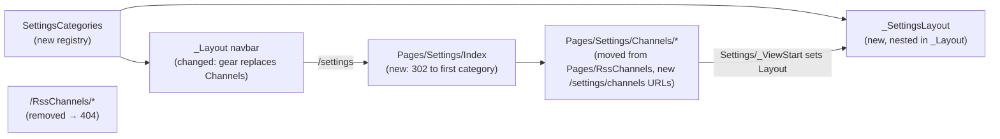

# Settings panel

Brief: [.ai/specs/briefs/2026-10-07-settings-panel.md](briefs/2026-10-07-settings-panel.md).

## 📝 TLDR
Today channel management is a `Channels` link in the navbar at `/RssChannels`, and its table spills off the screen on phones. After this change, a gear icon opens a **Settings** area at `/settings` with a category menu. **Channels** is its first category, at `/settings/channels`. The old `/RssChannels/*` URLs are removed. On screens narrower than 768px the channel table drops two columns and folds its three action buttons into one "⋯" menu, so it fits a 360px phone without sideways scrolling.

## 📝 Resolved assumptions (autonomous defaults)

The owner settled every product decision in the brief (its *Resolved unknowns* table is authoritative). Only these implementation-level questions were left open. Q1–Q3 were defaulted here, and the owner confirmed Q4:

| # | Question | Applied default | Why | Confirm? |
|---|----------|-----------------|-----|----------|
| Q1 | How are lowercase `/settings/...` URLs enforced (the brief asks for an explicit mechanism)? | **Explicit absolute `@page` route templates** on each moved page (e.g. `@page "/settings/channels/edit/{id:int}"`), not the global `LowercaseUrls` option. | It's contained to the moved pages. `LowercaseUrls` would also rewrite every other generated link (`/News` → `/news`), which nobody asked for. `asp-page` links are generated from the template, so they come out lowercase too. | reversible |
| Q2 | What does an old `/RssChannels/*` URL show? | The framework's default **404**, with no custom error page. | The brief removes the routes. A friendly 404 page is a separate, app-wide concern. | reversible |
| Q3 | How should the table behave between 768px and 991px (tablet), where all five columns are shown in the narrower panel column? | **Unchanged:** the full table keeps today's horizontal-scroll container from 768px up. The no-scroll guarantee applies below 768px. | The brief's acceptance criteria target phones (360px). Hiding more columns on tablets would be new scope. | reversible |
| Q4 | Which test framework does the repository's first test project use? `AGENTS.md` (Tests row) says it "should be agreed first", and the brief doesn't decide it, so the owner confirmed it. | **xUnit + `Microsoft.AspNetCore.Mvc.Testing`** (`WebApplicationFactory` with faked Application services, no Postgres). | It's the ASP.NET Core default for in-memory integration tests and is needed to verify routes, links and markup. | confirmed by owner |

## 📝 Problem Statement
- Channels is configuration, not content, yet it sits in the primary navbar next to `News`. Every future configuration screen would add another top-level link.
- The owner wants every settings page under a `/settings/` URL prefix, so the channel pages leave `/RssChannels/*`.
- The channel table doesn't work on phones. On a 390px phone, the Description, Added at and Actions columns overflow, so Fetch now, Edit and Delete can only be reached by scrolling sideways.

## 📝 Proposed Solution
**Phase 1: the Settings panel and its URLs**
- **Gear in the navbar.** The `Channels` nav item becomes a right-aligned gear (`bi-gear`, filled `bi-gear-fill` when active) linking to `/settings`. It has `aria-label="Settings"`, a `title`, and a visible label `<span class="d-sm-none ms-1">Settings</span>` below the `sm` breakpoint, where the collapsed menu lists it vertically. Bootstrap 5.1 has no responsive `visually-hidden`, so the `aria-label` names the link at every width. It is active (with `aria-current="page"`) on every page that belongs to a settings category.
- **`/settings` entry page.** It redirects (302) to the first registered category, or returns 404 if the registry is empty.
- **Category registry.** `Home.Scout.Web/Settings/SettingsCategories.cs` holds an ordered list of `SettingsCategory(Key, Title, Icon, EntryPage, PagePrefix)`, where `PagePrefix` is a Razor **page path** (`/Settings/Channels`), not a URL. `FindForPage(pagePath)` matches the prefix exactly or with `prefix + "/"`. Both the layout menu and the gear's active state read from it, taking the current page path from `ViewContext.RouteData.Values["page"] as string` (e.g. `/Settings/Channels/Edit`).
- **Settings layout.** `Pages/Shared/_SettingsLayout.cshtml` nests in `_Layout`. It contains a "Settings" heading, a `<nav aria-label="Settings categories">` pill menu (vertical from `md` up, a horizontal row above the content below `md`), and the page body. It **must** re-render `@section Scripts`, because Create and Edit define it for client-side validation, and Razor throws "section defined but not rendered" otherwise.
- **Channel pages move.** `Pages/RssChannels/*` move to `Pages/Settings/Channels/*` (namespace `Home.Scout.Web.Pages.Settings.Channels`) with absolute routes (Q1): `/settings/channels`, `/settings/channels/create`, `/settings/channels/edit/{id:int}`, `/settings/channels/delete/{id:int}`. `Pages/Settings/_ViewStart.cshtml` sets `Layout = "_SettingsLayout"`. The page models and handlers (including `FetchNow`) are unchanged apart from the namespace. Their relative `RedirectToPage("Index")` calls still resolve within the folder.
- **Old URLs removed.** No page answers `/RssChannels/*`, so those URLs return 404 (Q2).
- **Links updated.** Every hardcoded `/RssChannels...` href moves to its `/settings/channels...` equivalent: the Index header and empty state, the Edit/Delete row links, the Cancel and Return links in Create/Edit/Delete, and the `/News` empty-state link (`News/Index.cshtml:71`).
- **Wrappers removed, forms full width.** All four channel views (Index, Create, Edit, Delete) drop their outer `container py-4`, because a nested `.container` would add another gutter inside the panel column and shrink the table at 360px. Create, Edit and Delete also drop `col-md-8 offset-md-2` and fill the content column.
- **Contract record.** `BACKWARD_COMPATIBILITY.md` §3 is amended in the same PR (see Risks).

**Phase 2: the phone-friendly channel table**
- Below `md` (<768px): the Description and Added at columns are hidden (`d-none d-md-table-cell` on `th` and `td`), and the Actions cell shows one "⋯" dropdown toggle (`d-md-none`) instead of the three buttons (`d-none d-md-inline-flex`). The dropdown holds **Fetch now** (a `<button type="submit">` inside its own `FetchNow` POST form, built with the same form tag helper as the md-up button so antiforgery is kept; each row therefore renders two forms, one per breakpoint), **Edit** and **Delete** (danger-styled), aligned `dropdown-menu-end`. The toggle's accessible name is `Actions for {channel name}`.
- **No clipping, no sideways scroll.** Below `md` the table is **not** inside an overflow container: the wrapper becomes `.channels-table`, and a `site.css` rule gives it `overflow-x: auto` only `@media (min-width: 768px)`. With no clipping ancestor, the dropdown renders in full. Below `md` the table uses `table-layout: fixed; width: 100%`, and the action column is `3rem` wide. The Name column is `40%` wide and URL takes the remaining width. The Name cell gets `text-truncate` with the full value in `title`. The URL anchor (today `text-truncate d-inline-block` with an inline `max-width: 250px`, `Index.cshtml:46`) loses the inline `max-width` and becomes `d-block text-truncate` with `title`, so the ellipsis appears at the cell edge instead of the cell silently clipping a 250px anchor. Long names and URLs end in an ellipsis instead of widening the table.
- From `md` up the table looks and behaves as it does today (Q3).

**Alternatives considered** (decided in the brief):
- An offcanvas drawer or modal. Rejected because the CRUD forms are server-validated full pages.
- Categories stored in the database. Rejected because there are no setting values yet.
- Redirects from the old URLs. Rejected knowingly by the owner.
- Cards, or sticky action buttons, for the table. The owner chose the slimmed table.
- Deferring the table fix. Rejected by the owner, who kept it as its own phase so it can be split off.

**Market check:**
- FreshRSS and Tiny Tiny RSS both put configuration behind a gear or "Preferences" entry with a category menu, with feed management as one category. This design matches.
- Both list feeds compactly on mobile with per-row overflow menus, which is the same pattern as the "⋯" menu here.
- Both carry per-user preference storage, which this spec deliberately skips.

## 📝 Architecture
Web layer only. Domain, Application, Infrastructure, the worker and the database are untouched.



The registry is the single source of truth for which pages are "settings". Adding a category is one registry line plus pages under `Pages/Settings/{Category}/`, with no change to `_Layout`.

## 📝 UI/UX

```
Desktop ≥ md                                         Phone < md (360px)
┌ Scout  News                          ⚙ ┐            ┌ Scout                ☰ ┐
│ Settings                               │            │ Settings                │
│ ┌────────────┐ RSS Channels  [+ Add]   │            │ [▌Channels]             │
│ │▌ Channels  │ Name│URL│Desc│Added│Act │            │ RSS Channels    [+ Add] │
│ └────────────┘ ...full table...        │            │ Name      │ URL…   │ ⋯ │
└────────────────────────────────────────┘            │ BBC News  │ https… │ ⋯ │
                                                      └─────────────────────────┘
                                                        ⋯ → Fetch now / Edit / Delete
```

- **Active states.** The gear is active on every `/settings/channels*` page. The `Channels` menu item is active on the list, Create, Edit and Delete pages.
- **Accessibility.** The gear has `aria-label`, a `title`, and a visible label only below `sm`. The menu is `<nav aria-label="Settings categories">`. The "⋯" toggle carries a per-row accessible name. The dropdown is keyboard-operable through Bootstrap's dropdown component.
- **Unchanged.** Page content, headings, the status alert after Fetch now, the empty state and the validation behaviour all stay the same.
- **Prototype.** None. Mockups were skipped (no test environment prepared); see the PR.

## 📝 Edge Cases & Failure Scenarios
- **An old bookmark** to `/RssChannels/...` gets a 404. This is accepted by the owner (single-user, self-hosted). The PR and §3 record it.
- **Empty registry** (a future misconfiguration): `/settings` returns 404. A unit test pins that the registry is non-empty.
- **Fetch now from the "⋯" menu** posts to `/settings/channels?handler=FetchNow&id={id}` (`asp-route-id` is not in the route template, so it travels as a query value), then redirects back to `/settings/channels` with the status alert. Antiforgery is preserved because the button sits inside the form tag helper.
- **A very long channel name or URL** is truncated with an ellipsis below `md`, with the full value in `title`. From `md` up, today's horizontal-scroll fallback still applies.
- **Bootstrap Icons CDN unavailable:** the gear and "⋯" icons disappear, but the gear's `aria-label` and `title`, its visible label below `sm`, and the toggle's accessible name keep them usable. This is the same dependency the app already has on every page.
- **Errors on channel pages** (e.g. the database is down): behaviour is unchanged and renders inside the settings layout.

## 📝 Risks & Impact Review
- **Contract break, by owner decision.** Removing `/RssChannels`, `/RssChannels/Create`, `/RssChannels/Edit/{id:int}`, `/RssChannels/Delete/{id:int}` and the `FetchNow` handler on `/RssChannels` breaks `BACKWARD_COMPATIBILITY.md` §3, whose required path is a redirect. The owner explicitly rejected redirects. To keep the contract document truthful, the same PR amends §3:
  - it replaces the listed channel routes with `/settings`, `/settings/channels`, `/settings/channels/create`, `/settings/channels/edit/{id:int}`, `/settings/channels/delete/{id:int}` and the `FetchNow` handler on `/settings/channels`,
  - it adds a dated note: "`/RssChannels/*` removed without redirects (owner decision, settings panel; single-user self-hosted install, no external links)".

  Code review should treat the break as approved only when this amendment is in the diff.
- **Shared layout.** `_Layout` renders on every page, so a regression shows up everywhere. Integration tests cover `/News` and every settings page.
- **Rollback.** Revert the PR. There is no state to undo, and the old URLs come back with the revert.
- **QA.** User-facing navigation and a responsive layout change, so `needs-qa` applies. The 360px criteria can only be verified in a real browser (`om-auto-qa-pr`); integration tests pin the markup that produces them.

## 📋 Phasing
- **Phase 1: Settings panel and `/settings` URLs.** Test harness, registry, `/settings`, the moved pages in the settings layout, the gear, link updates, full-width forms and §3. Shippable alone: everything works at the new URLs, and the table behaves as today.
- **Phase 2: Phone-friendly channel table.** Shippable alone on top of Phase 1, and can be split into its own PR if it fails QA.

## 📋 Implementation Plan

### Phase 1: Settings panel and `/settings` URLs
1. **Add a web test project.** Create `tests/Home.Scout.Web.Tests` (xUnit + `Microsoft.AspNetCore.Mvc.Testing`), add it to `Home.Scout.sln`, and add a `WebApplicationFactory<Program>` fixture that replaces `IChannelService` (seeded with one channel, id 1), `IRssSyncService` and `INewsItemService` with in-memory fakes through `ConfigureTestServices`, so no Postgres is needed. Expose `public partial class Program;`. The fixture also offers a client created with `AllowAutoRedirect = false` for redirect assertions. Test: a smoke test confirms GET `/News` renders the layout.
2. **Add the category registry.** Add `Settings/SettingsCategories.cs` with the `Channels` entry (`EntryPage = "/Settings/Channels/Index"`, `PagePrefix = "/Settings/Channels"`) and `FindForPage`. Unit tests: the registry is non-empty with unique keys; `/Settings/Channels/Edit` maps to channels; `/News/Index`, `/Settings/ChannelsArchive` and `/Settings/Index` map to none.
3. **Add the `/settings` entry page.** Add `Pages/Settings/Index` with `@page "/settings"`, returning `RedirectToPage(first.EntryPage)` or 404. Integration test, using the non-redirecting client: GET `/settings` returns 302 with `Location: /settings/channels`.
4. **Move the channel pages into the settings panel.** Move `Pages/RssChannels/*` to `Pages/Settings/Channels/*` with the absolute routes, and update the namespaces and the views' `@model` directives. Add `_SettingsLayout` (with the re-rendered `Scripts` section) and `Pages/Settings/_ViewStart.cshtml`. Drop the outer `container py-4` from all four views and `col-md-8 offset-md-2` from Create, Edit and Delete. Update every hardcoded link, including `/News`. Integration tests:
   - `/settings/channels`, `/create`, `/edit/1` and `/delete/1` return 200 and contain the `Settings categories` nav with `Channels` active;
   - every href matching `(?i)/settings` is lowercase (other links such as `/News` and static assets are out of scope for this check);
   - Create and Edit render the jquery-validate scripts;
   - `/RssChannels`, `/RssChannels/Create` and `/RssChannels/Edit/1` return 404;
   - the `/News` empty state links to `/settings/channels`;
   - no rendered page contains `href="/RssChannels`.
5. **Replace the Channels link with the gear.** Change `_Layout` as described above. Integration tests: `/News` has the gear (`href="/settings"`, `aria-label="Settings"`, outline icon, no `aria-current`) and no `Channels` nav link; the settings pages mark the gear active with `aria-current="page"` and the filled icon.
6. **Amend `BACKWARD_COMPATIBILITY.md` §3.** Make the route list and removal note described under Risks. This is docs-only; the review checks it against the routes asserted in step 4.

### Phase 2: Phone-friendly channel table
1. **Slim the table below `md`.** Add the responsive column classes, the "⋯" dropdown (with Fetch now inside the POST form, plus Edit and Delete) and the md-up button group. Integration tests on `/settings/channels`:
   - the Description and Added at `th`/`td` carry `d-none d-md-table-cell`;
   - each row has a `d-md-none` dropdown toggle named `Actions for {name}`, whose menu contains a POST form to `?handler=FetchNow&id={id}` with an antiforgery token, and links to `/settings/channels/edit/1` and `/settings/channels/delete/1`.
2. **Remove sideways scroll and clipping below `md`.** Replace `.table-responsive` with `.channels-table` and add the `site.css` rules (overflow only at ≥768px; fixed layout, truncation and a narrow action column below). Integration test: the list page has no `table-responsive` wrapper, the Name cell and the URL anchor carry `text-truncate` with a `title`, and the URL anchor has no inline `max-width` style. Browser QA (`om-auto-qa-pr`) at 360px verifies the acceptance criteria: no horizontal scroll, the dropdown opens fully, long values are truncated.
